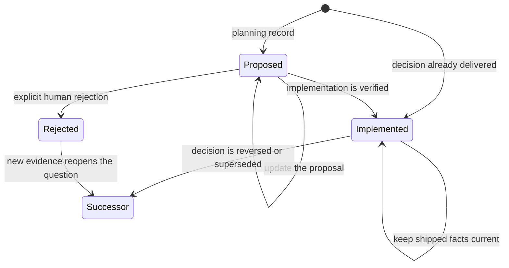

# Agent Notes

English | [中文](README.zh.md)

An Agent Note records a decision a maintainer may reasonably revisit: the problem, the chosen behavior, what alternatives lost, the accepted cost, and the evidence that makes the result complete. It is repository rationale, not authority over current code.

## Layout and classification

Notes live at `{lifecycle}/{class}/yyyy-mm-dd-topic.md`.

Lifecycle:

- `proposed/` — a decision being discussed or implemented.
- `implemented/` — shipped reality, kept factually current.
- `rejected/` — an explicitly declined proposal retained only while its rationale prevents a plausible repeated mistake.

Class:

| Class | Use |
|---|---|
| `feature` | User- or model-facing capability. |
| `bug-fix` | Durable root cause and repair decision. |
| `simplification` | Removal or collapse of existing behavior or structure. |
| `architecture` | Shipped source ownership and dependency decisions. |
| `process` | Repository tooling, policy, and workflow. |
| `testing` | Test infrastructure and strategy. |

There is no `refactor` class. A refactor with a durable removal decision is a simplification; a mechanical refactor needs no note.

### Initial lifecycle selection

Use `proposed/` for a decision still being discussed or implemented. Use `implemented/` when the decision has shipped and the evidence is available. Use `rejected/` only to record an explicit rejection of an existing proposal.

### State transitions



`Successor` means a new, cross-linked note that preserves the existing decision record.

## When to use a note

Agent Notes are optional in TinyCherry. Consider one for a durable decision about architecture, compatibility, persistent data, or a repair whose reasoning a maintainer may revisit. Prefer updating the note that already owns the decision.

## Optional planning and review

A proposal can be discussed in an issue, in the implementation PR, or separately. A dedicated Spec PR and a PR stack are optional. If work spans several PRs, mark a note implemented once the combined verification covers the decision.

## File format

Every note starts with this exact header block, followed by the language switcher:

```markdown
# Agent Note: <title>

Status: <lifecycle>

English | Chinese counterpart: yyyy-mm-dd-topic.zh.md
```

A proposed note contains:

```markdown
## Problem
## Proposal
## Alternatives considered
## Acceptance criteria
## Risks
```

Acceptance criteria are observable outcomes, not implementation tasks:

```markdown
- AC1 — <observable result> (verification: unit | renderer | Electron | packaged artifact | docs gate)
```

Acceptance-criterion entries are machine-readable, single-line, top-level list items. Use the exact `-` form above;
entries expressed with alternative markers, indentation, block quotes, or multiline content are rejected. Code blocks
and raw HTML do not count as entries. Supporting context may remain in prose or list items that do not introduce
another AC ID.

An implemented note contains:

```markdown
## Problem
## Decision
## Alternatives considered
## Consequences
## Verification
```

Transitioned Specs map every AC to actual evidence. A direct bug-fix note may use `Regression` instead:

```markdown
- AC1 — `<command or test>`: <what regression it catches>
- Regression — `<command or test>`: <what regression it catches>
```

Verification entries follow the same single-line, top-level list rule.

A rejected note retains `Problem`, `Proposal`, and `Alternatives considered`, adds `Rejection rationale`, and uses:

```markdown
Status: rejected — <one-line decisive reason>
```

## Rejection and deletion

Only an explicit human decision moves `proposed` to `rejected`. For a partial rejection, update the proposed note to reflect the decision. Keep discussion alternatives in `Alternatives considered`.

Keep a rejected note when its rationale can prevent a likely repeated mistake. If the exploration has no durable value, close the unmerged PR without adding repository noise. An implemented decision is never relabeled rejected; a new note supersedes it.

## Supersession

Before adding a note, search active notes by domain terms, mechanism names, paths, and rejected alternatives.

- New decision: create a note.
- Same decision: update the current owner.
- Partial supersession: keep both notes current and cross-link them.
- Full supersession: move every unique rationale, alternative, consequence, and verification fact into the new owner. Deleting the old note requires explicit human approval.

Do not rewrite a note into a different decision or use Git history as the only remaining rationale.

## Archived notes (deferred)

Cherry Studio does not currently have an `archived/` lifecycle, directory, or valid status. Age, a merged PR, moved code, or stale wording never archives a note automatically. An implemented note that still owns a current decision stays active and is updated in place.

Introduce an archive only when all of these repository-level conditions hold:

1. Fully superseded or removed-domain notes have accumulated enough to measurably weaken active-tree search.
2. Active-first and historical fallback search behavior is defined for agents.
3. An archive index or equivalent owner mapping keeps successors discoverable.
4. Pairing, format, supersession, and inbound-link gates understand the new lifecycle.
5. The change is approved as a repository process decision rather than inferred from note age.

Once that lifecycle exists, only an implemented or rejected note is eligible, and only when:

- it is fully superseded or its entire owning system has been removed;
- a current owner has absorbed every unique rationale, alternative, consequence, and verification fact;
- successor and inbound links identify the active owner; and
- a human explicitly confirms the supersession and archive move.

A proposed note never enters archived. An explicitly declined proposal becomes rejected when its rationale has durable value; an unmerged exploration without durable value is closed without adding a repository record. Until archive support is implemented, fully superseded notes remain active and cross-linked, and deleting one still requires explicit human approval.

## Lifecycle transitions

`proposed → implemented` is a rewrite to shipped present tense: `Proposal` becomes `Decision`; plans and checklists become actual `Consequences` and `Verification`. Move the English file, Chinese file, and sidecar together.

`proposed → rejected` preserves what was considered, adds the explicit verdict and evidence, and stops every implementation layer. A later proposal with new evidence links the rejected record rather than erasing it.

Implemented notes keep paths, names, defaults, ownership, failures, and verification current. When implementation and a note disagree, determine whether the code is wrong or the factual realization changed; do not preserve a worse implementation merely to satisfy stale prose.

Before publishing a lifecycle move, run `pnpm agent-notes:check-transition --base <verified-spec-ref> [--head <ref>]`. The checker requires a complete English/Chinese/sidecar move, permits only `proposed → implemented|rejected`, maps every approved AC exactly once for implementation, and requires an explicit rejection reason. It validates a declared transition; it never decides that a proposal was rejected or that a stack is complete.

## Pairing and gates

Every note and this README follow [the bilingual pairing contract](../../docs/dev/i18n/README.md). Agent instruction files remain English-only.

Run:

- `pnpm docs:check-notes` for format and lifecycle structure.
- `pnpm agent-notes:check-transition --base <verified-spec-ref>` for a lifecycle move.
- `pnpm docs:check-pairing <pair>` while editing a pair.
- `pnpm docs:check` before publishing documentation changes.

The [implemented documentation-governance decision](implemented/process/2026-08-18-docs-governance-and-spec-workflow.md) owns this workflow.
