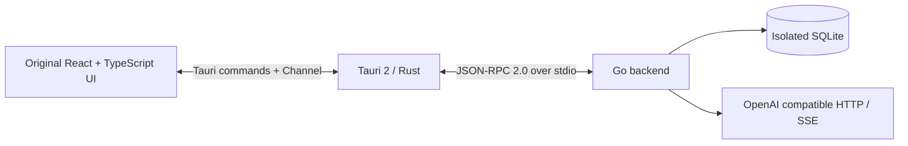

# TinyCherry EvoStack

Experimental Windows x64 desktop host, branched from `83ddd5703fcc5391c26c0e784559a8a3a77251eb` (TinyCherry 2.1.10). This target reuses the React UI with host-specific adaptations while retaining the separate Electron build.



## Implemented slice

- Original onboarding, navigation, settings, provider/model selectors, assistant and chat components, styles and translations.
- EvoStack's welcome screen uses a primary provider-setup button and an outlined Set Up Later button below it, without CherryIN sign-in or privacy-consent controls. It does not record privacy acceptance, and data collection defaults to disabled.
- Rust owns the native window, window buttons/dragging, external HTTP(S) links, WebView2 profile and Go process lifetime.
- Go owns provider/model/assistant/topic storage, preferences, message trees and basic text chat using the `openai-chat-completions` endpoint.
- Context-clear markers and global/assistant history windows affect the actual provider payload. A newly added leaf boundary can be cancelled without deleting its history; a boundary with descendants is retained. An absent assistant window inherits the global value; `null` removes that limit. Context compression and tool-output offloading are unavailable and disabled in the native UI.
- Provider chat, model listing and checks share endpoint profiles, custom headers, application proxy settings and bounded request deadlines. Checks validate a completion body instead of treating HTTP 200 alone as success.
- Knowledge bases use the original React workspace with Go-owned SQLite FTS5 retrieval. Notes, URLs and UTF-8 text/Markdown/CSV/JSON/HTML files can be indexed, searched, previewed and attached to assistant chats. This slice uses BM25/full-text retrieval; embeddings, reranking, directory ingestion, PDF/OCR processing and group management are not connected and are disabled in the native interface.
- Prompt settings persist the original prompt, target-binding and ordering DTOs in Go, including optimistic concurrency checks for global visibility changes.
- The skill catalog includes packaged built-in skills with persistent enablement, file browsing and local management. Skill management does not imply that the Agent execution engine is migrated.
- Computer Use in ordinary assistant chats uses the existing Windows native helper. Go runs the model/tool loop; Rust owns private helper sessions, application ownership, snapshots and cancellation. Observation requests `activation: never`, and actions disallow global input. Unsupported background actions fail explicitly; background keyboard dispatch is disabled in this slice.
- Incremental text/reasoning output, stream attachment/replay, stop and partial-answer persistence. Interrupted streams fail rather than becoming successful replies. Requests are never automatically replayed.
- Original conversation/assistant archive, restore, permanent-delete and Undo flows use the shared Trash protocol. Related pins and group references are updated in the same transaction. Model IDs preserve raw greedy tails, including slashes and percent literals; an encoded alias is decoded once only when no exact raw model ID exists.
- SQLite WAL, transaction rollback and recovery of replies left pending after a crash. API keys are protected with Windows DPAPI in the SQLite secret table; provider snapshots contain key metadata only.
- All backend traffic uses private stdio pipes. There is no local HTTP/WebSocket listener and no Electron or Node runtime in the portable package.

This is a working migration slice, not feature parity. Agent runtimes (Claude Code/Pi), MCP, chat attachments, browser automation, painting, translation, backups/imports, tray/global shortcuts, multi-window, multi-model groups, advanced reasoning controls and downloads are not migrated. Their original screens may still be reachable; unsupported actions return `EVOSTACK_NOT_MIGRATED` instead of claiming success. Knowledge bases are retained again; the native full-text path is independent of the original `sqlite-vec` store. Existing renderer cache/SWR state is retained for this slice; a wholesale Zustand conversion is not part of it.

## Data and provider setup

The default profile is `evostack-data` next to `TinyCherry-EvoStack.exe`. It contains `evostack.sqlite3`, WebView2 data and a process-owned lock. A second backend cannot acquire that profile. `TINYCHERRY_EVOSTACK_DATA_DIR` overrides it with an **absolute** path for isolated verification.

The database is a new, versioned EvoStack schema storing the existing UI DTOs. It is **not** a Drizzle-compatible replacement. Do not point this trial at an Electron profile or copy a production database into it. An importer for existing Electron conversation/provider/knowledge data requires separate work. This trial does not read or migrate the user's existing Electron data. Native schema v3 adds the knowledge full-text index; knowledge snapshots and managed skill files remain inside the selected native profile.

Use the original Settings → Providers UI to enable a provider, configure its **OpenAI Chat Completions** base URL and API key, and add/sync a model. Choose that model in Settings → Default Model. Custom compatible providers and local compatible endpoints work through the same UI. Other endpoint families return an explicit migration error. No live provider or real API key is used by the verification scripts.

Application proxy modes are system, custom and none, with explicit bypass rules. Windows system mode reads the current user's Windows proxy settings, including PAC/WPAD. Custom mode supports HTTP, HTTPS and SOCKS5/SOCKS5h (`socks` aliases SOCKS5); SOCKS4 is rejected instead of silently connecting directly. Knowledge URL imports share the application proxy policy and do not inherit a provider's authentication headers. Effective settings are copied for each HTTP request, so a settings change affects later requests without mutating one already in flight. Connection pools are configuration-specific, bounded and closed on backend shutdown.

Knowledge imports fetch/read and split materials before taking the write transaction. The commit rechecks the base and material identities; concurrent changes reject the prepared result without partial indexing. Retrieval builds its own bounded query while preserving the complete user question, and combines BM25 candidates with bounded short-term matches. Native chunk-size, overlap and preview counts are Unicode character counts. The retained DTO's `tokenCount` field carries that character count in this slice; the native interface labels it as characters and does not promise model-token accounting or Markdown-aware splitting.

## Computer Use

Enable Settings → Computer Use → Allow agents to control desktop applications to make nine original computer tools available to ordinary assistant chats. The selected model must support Chat Completions function calls. Vision-capable models can also receive the latest target-window screenshot; accessibility observations remain available to text models. This does not enable the separate Claude Code/Pi Agent runtimes or a Node REPL.

`press_key` is not exposed to models and is rejected before dispatch. The pinned Windows helper sends keys to the application's root window without reliably routing them to the focused control; its completed result did not produce a Return event in the test editor. Use clickable buttons and editable controls instead. Other background actions also depend on the target application's accessibility and window-message support: a completed dispatch is not proof that the intended task succeeded. Inspect the resulting observation. The host does not request window activation or global input, but the target application can still change its own focus in response to an accessibility action.

Each chat turn owns its application sessions and snapshots. The tools open control sessions for already-running applications; they do not launch applications. Every action requires a fresh snapshot from the same task. A turn is limited to 16 model steps and 32 sequential tool calls. Only complete tool-call streams may execute; network requests and desktop actions are never automatically replayed. An unconfirmed effect terminates the tool loop.

Stop Generating cancels the current task. Switching Computer Use off revokes all active desktop-capable turns and closes their private helpers. The user must enable the switch again before new control is allowed. Closing TinyCherry or losing the Go process also closes the helpers; it does not quit the target applications. Unconfirmed cleanup keeps control unavailable instead of silently reopening a session.

Action inputs, accessibility observations and outcomes remain in the chat history. Screenshot bytes are temporary model input, limited to the latest image; they are not stored in SQLite or replay frames. Oversized screenshots are reported unavailable rather than silently resized, preserving the coordinate contract. Interrupted actions are retained as unconfirmed errors, not resumed after restart.

DPAPI keys are bound to the current Windows user; moving the folder to another Windows account requires entering the API keys again. The first slice limits a reply to 1 MiB and 8192 stream frames, with a ten-minute generation deadline.

Archive is reversible and preserves the message tree. Permanent deletion is explicit: deleting a topic removes its messages and pins; deleting an assistant follows the shared `deleteTopics` option; deleting a provider removes its models and unreferenced secrets. Deleting a group clears matching assistant/knowledge-base group references. Model deletion clears current model references and default/fallback preferences while retaining message text and historical snapshots. Resources used by an active generation must be stopped before deletion. Each transaction owns a callback-local repository executor; the shared store never points at an in-flight transaction. Schema v3 retains the isolated JSON entities and FTS5 index, with scoped indexes for message and knowledge lookups.

Non-GET DataApi mutations are never automatically retried. If their reply is lost or delayed beyond the client deadline, the result is unknown: inspect the authoritative data before manually retrying. Transport request IDs are not business idempotency keys, and this slice does not claim durable mutation deduplication across new user requests.

## Build

Requires the workspace's Node/pnpm dependencies, Go 1.27+, Rust 1.98+/MSVC and an installed Microsoft Edge WebView2 Runtime. Windows Computer Use also needs the system Windows PowerShell runtime and an interactive desktop. Go race checks additionally require a MinGW-w64-compatible C compiler with `libsynchronization.a`. Dependencies are pinned by `go.sum` and `src-tauri/Cargo.lock`. No global environment settings are changed.

From the repository root:

```powershell
powershell -NoProfile -ExecutionPolicy Bypass -File native/evostack/build.ps1
```

The script keeps Go/Cargo/npm caches, temporary files and outputs under this directory. It generates the UI before the first Rust compilation, including tests and Clippy, so a checkout without `dist/frontend` can build. Renderer types, Rust fmt/tests/Clippy and Go integration checks remain enabled. Each build uses a fresh staging directory and an eight-file whitelist; the previous portable folder is preserved under `.cache/portable-backups` before replacement. Package checks compare the app version, source revision and protocol of both x64 executables, then start an isolated window/Go process. A smoke-only token/PID/revision handshake confirms React is ready, and the original Set Up Later button must persist the skipped state and open the workspace before graceful shutdown. Normal launches do not enable this handshake or CDP. SHA256 hashes and the ZIP are generated from those staged files only. The portable folder and ZIP are in `dist/`. The main EXE, `tinycherry-evostack-backend.exe` and `open-computer-use.exe` must stay together. The computer-use helper and its MIT/third-party notices come from the pinned installed Windows x64 package version `0.1.9`; it adds no Node runtime. This is a portable directory/ZIP, not a standalone single-file EXE. No installer, registration or automatic updater runs.

`test-race.ps1` runs `go test -race -count=10` when a compatible Windows MinGW-w64 `gcc` is available; it fails explicitly if that prerequisite is missing. The Windows workflow runs this check separately from ordinary tests and builds a smoke-tested ZIP artifact. Adding the workflow does not itself prove a cloud run has passed. See [Go's race-detector prerequisites](https://go.dev/doc/articles/race_detector#Requirements).

## Verification

Default packaging explicitly runs the pinned helper's private-session permission/capability preflight and owned-process descendant cleanup tests. These checks do not discover applications or send desktop input. The original renderer/DataApi-to-Go mutation delivery tests also run against that staged backend executable.

```powershell
. ./native/evostack/prepare-env.ps1
pnpm exec tsx --tsconfig tsconfig.web.json native/evostack/generate-contract.ts
Push-Location native/evostack/backend
go test -v -timeout 60s ./...
Pop-Location
pnpm exec tsx --tsconfig tsconfig.web.json native/evostack/check-contract.ts
```

Go tests use real temporary SQLite databases and loopback-only synthetic model servers. The contract check launches the compiled Go executable, exercises JSON-RPC and validates returned DTOs against the original Zod schemas. `check-computer-contract.ts` additionally feeds ordinary text and multi-step computer tool chunks through the original AI SDK stream reader, using a fake reverse host without desktop input. Evidence is written to `.cache/contract-*` and `.cache/computer-contract-*`. Windows sandbox policies may require running loopback tests outside a network-restricted sandbox.

For UI verification, start the packaged EXE with a new project-local `TINYCHERRY_EVOSTACK_DATA_DIR` and a dedicated `WEBVIEW2_ADDITIONAL_BROWSER_ARGUMENTS=--remote-debugging-port=<unused-port>`. Attach only to that instance's `tauri.localhost/windows/evostack/index.html` target. Debug arguments are not set in normal launches. Screenshots and test logs belong in this directory's ignored `.cache/`.

## Protocol ownership

Rust sends bounded, newline-delimited JSON-RPC 2.0 frames (`ipc.invoke`, `backend.info`, `backend.shutdown`). A bounded writer owns stdin; request deadlines include queueing, pipe writing and response waiting. A blocked write causes an independent supervisor to terminate the owned backend instead of waiting for that same pipe during shutdown. Requests are not replayed. Go returns correlated responses and `event` notifications containing the original renderer IPC envelope. Maximum frame size is 4 MiB. Stdout is reserved for the protocol. Rust relays events through a window-owned Tauri Channel; it does not expose process spawning or arbitrary filesystem commands to JavaScript.

Go invokes the fixed native computer bridge through reverse `host.computer` requests with string IDs; ordinary Rust requests retain numeric IDs. Reverse responses bypass Go's request slots and SQLite lock. `host.computer.cancel` cancels an owned task. A monotonic configuration epoch prevents a delayed enable or action from superseding a newer user revocation. Rust grants each task from private open-response metadata against the user request's captured stop version; an acknowledgement arriving after Stop cannot grant control. The metadata is not exposed in the renderer acknowledgement. Overloaded request queues return an explicit busy error while continuing to consume reverse responses.

Each generation has a monotonic attempt ID, per-attempt sequence and persisted assistant-row anchor. Replay coalesces adjacent deltas with continuous sequence coverage and uses encoded-byte budgets; live chunks retain their original sequences. Snapshots do not mutate after attachment. Aborting has an independent cancellation route, then drains/persists the partial reply before acknowledging. Shutdown cancels active work; loss of the parent pipe also terminates the backend. A dead backend is not automatically restarted because model calls and future tool actions must not be silently repeated.

`finish_reason` describes the result but is not the transport completion marker. A complete SSE `[DONE]` event is required; EOF, error events or truncated event framing before it fail and persist the partial reply. Host request deadlines distinguish ordinary calls (15 s), bounded provider probes (45 s outside Go's 30 s HTTP deadline), cancellation (5 s) and shutdown (2 s). Late replies are discarded by request ID and never retried.

Sidecar stderr and lifecycle status go to `backend-stderr.log` in the selected profile, with one rotated backup and a 512 KiB limit per file. The log records exit codes and safe startup/panic categories. Arbitrary stderr payloads are suppressed because panic/error text can contain provider credentials; stdout remains JSON-RPC only.

## Next migration slices

1. Complete chat operations/endpoint families and native desktop behavior against the retained-feature acceptance matrix.
2. Port downloads, task scheduling and bounded concurrency into the same Go process.
3. Extend native knowledge retrieval with embedding/reranking and document processors, then validate old-data imports on disposable snapshots.
4. Port retained Agent/MCP/browser features with explicit runtime and system-integration choices. Introduce Zustand for appropriate UI state without making it a second business database.

## Electron compatibility boundary

| Surface | EvoStack behavior |
| --- | --- |
| `ipcRenderer.invoke` | Correlated asynchronous Tauri → stdio RPC; unsupported routes reject. |
| `send` | Queues `invoke` and reports rejection; not synchronous Electron one-way delivery. |
| `on`, `once`, `removeListener`, `off`, `removeAllListeners` | Renderer-local listeners; per-registration one-shot removal, cleared on page teardown. |
| `contextBridge.exposeInMainWorld` | Installs the compatibility object in this WebView's main world; not Electron context isolation. |
| `clipboard.readText/writeText` | WebView clipboard promises; permission/platform constraints apply. |
| `webFrame.insertCSS` | Adds a page-local style element. |
| `webFrame.setZoomFactor/setZoomLevel` | Native WebView zoom command. |
| `webUtils.getPathForFile` | Explicitly unsupported; attachments are outside this slice. |
| `sendSync`, `sendTo`, other Electron APIs | No implementation; callers must migrate before enabling those features. |

Only the packaged application origins are accepted for navigation and IPC. Production scripts do not allow `unsafe-eval`. Tauri's automatic CSP modification is disabled for `style-src` only, preserving the inline styles required by React and Markdown; script nonce/hash protection remains enabled. Provider snapshots contain key metadata, but the explicit API-key editor endpoint still decrypts values for compatibility with the original settings UI; DPAPI is storage protection, not protection against trusted renderer code. Do not put keys into logs, exported snapshots or diagnostics.

Official references: [Tauri sidecars](https://v2.tauri.app/develop/sidecar/), [Tauri Channels](https://v2.tauri.app/develop/calling-frontend/#channels), [JSON-RPC 2.0](https://www.jsonrpc.org/specification), [modernc SQLite](https://pkg.go.dev/modernc.org/sqlite).
