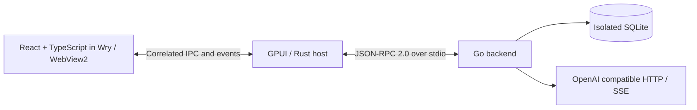

# TinyCherry

Windows x64 GPUI + Wry desktop host using TinyCherry's React UI and the Cherry Studio v2.2.2 shared contracts. This is the only desktop target.



## GPUI + Wry host

`src-gpui/` replaces the former desktop host. GPUI owns the native application/window and Wry attaches a child WebView2 to its content area. React, Tailwind/CSS, editor components and the Go business backend retain their existing responsibilities. Release builds embed the Vite output and serve it at `http://tauri.localhost/windows/evostack/index.html`; no development server or Node runtime is included in a portable package.

The `tauri` scheme and Windows `http://tauri.localhost` origin are deliberately retained as browser-storage identifiers. Together with the existing `evostack-data/webview` profile, they let the renderer reuse its existing `localStorage`, including the `cs_cache_persist` UI state. The name does not enable a Tauri runtime, API or dependency. This migration does not introduce another origin or copy/import browser storage.

The host pins `gpui = 0.2.2` and official `wry = 0.57.3`, with transitive versions recorded in `src-gpui/Cargo.lock`. Development CSP is supplied by the Vite response headers, including only the fixed loopback HTTP/WebSocket origin for HMR. Production CSP is supplied by the embedded asset protocol.

Startup first establishes the GPUI window and entity, then schedules WebView2 construction on the foreground UI executor. Construction runs outside GPUI App/entity update closures using the live native window handle; the finished view is installed in a subsequent update. The official Wry builder is synchronous and pumps Win32 messages internally, so it must not retain a GPUI borrow while waiting. WebView2 remains on the same UI STA thread throughout its lifetime; this is not a background-thread browser.

The renderer adapter lives in `src/platform/gpui/`. Requests carry an ID and a document session; replies and events are correlated before they reach the retained desktop API. Page teardown rejects pending requests, stale-document replies are discarded, and mutations are never automatically retried. The host accepts IPC only from the configured application origin, keeps desktop operations separate from Go requests, and retains the existing sidecar handshake and private helper lifecycle.

CSS continues to style the React content. GPUI-native elements require Rust styling. This host migration still uses WebView2 on Windows and makes no performance or IME improvement claim before a real-machine comparison. The React view occupies the native child rectangle; GPUI overlays must not be placed over it without separately validating Windows composition.

See [desktop architecture](../../docs/desktop.md) for the migration acceptance checks and retained/pending feature boundaries.

## Implemented slice

- Original onboarding, navigation, settings, provider/model selectors, assistant and chat components, styles and translations.
- EvoStack's welcome screen uses a primary provider-setup button and an outlined Set Up Later button below it, without CherryIN sign-in or privacy-consent controls. It does not record privacy acceptance, and data collection defaults to disabled.
- Rust owns the native window, window buttons/dragging, external HTTP(S) links, WebView2 profile and Go process lifetime.
- Go owns provider/model/assistant/topic storage, preferences, message trees and basic text chat using the `openai-chat-completions` endpoint. Temporary conversations stay in memory until explicitly saved, including when saved during generation.
- Assistant emoji and uploaded avatars retain registered file references for historical messages. The native renderer reads these entries into owned blob URLs without allowing arbitrary file URLs.
- The notification center stores local conversation results, unread state and dismissal in SQLite. Delivery follows the terminal-message commit; disabled delivery and acknowledged records do not reappear after restart. Unmigrated Agent/task targets remain unavailable.
- Context-clear markers and global/assistant history windows affect the actual provider payload. A newly added leaf boundary can be cancelled without deleting its history; a boundary with descendants is retained. An absent assistant window inherits the global value; `null` removes that limit. Context compression and tool-output offloading are unavailable and disabled in the native UI.
- Provider chat, model listing and checks share endpoint profiles, custom headers, application proxy settings and bounded request deadlines. Checks validate a completion body instead of treating HTTP 200 alone as success.
- Empty or malformed provider responses and context-limit rejections retain safe, structured diagnoses in stored messages and live projections. Provider response bodies are not included in these diagnoses. Reasoning-only replies remain valid.
- Links to registered Markdown snapshots in the current profile open in the existing read-only preview tab after backend metadata authorization. Relative paths and unregistered files are rejected.
- Knowledge bases use the original React workspace with Go-owned SQLite FTS5 retrieval. Notes, URLs and UTF-8 text/Markdown/CSV/JSON/HTML files can be indexed, searched, previewed and attached to assistant chats. This slice uses BM25/full-text retrieval; embeddings, reranking, directory ingestion, PDF/OCR processing and group management are not connected and are disabled in the native interface.
- Prompt settings persist the original prompt, target-binding and ordering DTOs in Go, including optimistic concurrency checks for global visibility changes.
- The skill catalog includes packaged built-in skills with persistent enablement, file browsing and local management. Skill management does not imply that the Agent execution engine is migrated.
- Computer Use in ordinary assistant chats uses the existing Windows native helper. Go runs the model/tool loop; Rust owns private helper sessions, application ownership, snapshots and cancellation. Observation requests `activation: never`, and actions disallow global input. Unsupported background actions fail explicitly; background keyboard dispatch is disabled in this slice.
- Incremental text/reasoning output uses revisioned message projections with immutable attachment baselines and reconnectable subscriptions. Stop preserves partial answers. Interrupted or lost-backend projections remain unresolved; reconnecting never replays a model request. The legacy stream protocol remains available to existing consumers.
- Original conversation/assistant archive, restore, permanent-delete and Undo flows use the shared Trash protocol. Related pins and group references are updated in the same transaction. Model IDs preserve raw greedy tails, including slashes and percent literals; an encoded alias is decoded once only when no exact raw model ID exists.
- SQLite WAL, transaction rollback and recovery of replies left pending after a crash. API keys are protected with Windows DPAPI in the SQLite secret table; provider snapshots contain key metadata only.
- Host–backend IPC uses private stdio pipes. ChatGPT sign-in briefly binds a loopback callback on `127.0.0.1` and closes it when the attempt ends. The portable package uses the native GPUI + Wry host and Go sidecar.

This is a working migration slice, not feature parity. Agent runtimes (Claude Code/Pi), MCP, chat attachments, browser automation, painting, translation, backups/imports, tray/global shortcuts, multi-window, multi-model groups, advanced reasoning controls and downloads are not migrated. Their routes show an unavailable shell and their primary navigation entries are hidden. Internal unsupported requests still fail explicitly. Knowledge bases are retained again; the native full-text path is independent of the original `sqlite-vec` store. Existing renderer cache/SWR state is retained for this slice; a wholesale Zustand conversion is not part of it.

## Data and provider setup

The default profile is `evostack-data` next to `TinyCherry.exe`. It contains `evostack.sqlite3`, WebView2 data under the existing `webview` subdirectory and a process-owned lock. The GPUI + Wry host retains these paths and the existing EvoStack schema. A second backend cannot acquire that profile. `TINYCHERRY_EVOSTACK_DATA_DIR` overrides it with an **absolute** path for isolated verification.

The database is a new, versioned EvoStack schema storing the existing UI DTOs. It is **not** a Drizzle-compatible replacement. Do not point this trial at an Electron profile or copy a production database into it. An importer for existing Electron conversation/provider/knowledge data requires separate work. This trial does not read or migrate the user's existing Electron data. Native schema v3 adds the knowledge full-text index; v4 preserves the disabled Computer Use default of older profiles when no explicit choice was saved. Explicit enable/disable choices are retained. Back up a profile before upgrading: older v3 binaries cannot open v4 databases. Knowledge snapshots and managed skill files remain inside the selected native profile.

Use the original Settings → Providers UI to enable a provider, configure its **OpenAI Chat Completions** base URL and API key, and add/sync a model. Choose that model in Settings → Default Model. Custom compatible providers and local compatible endpoints work through the same UI. Other endpoint families return an explicit migration error. No live provider or real API key is used by the verification scripts.

Application proxy modes are system, custom and none, with explicit bypass rules. Windows system mode reads the current user's Windows proxy settings, including PAC/WPAD. Custom mode supports HTTP, HTTPS and SOCKS5/SOCKS5h (`socks` aliases SOCKS5); SOCKS4 is rejected instead of silently connecting directly. Knowledge URL imports share the application proxy policy and do not inherit a provider's authentication headers. Effective settings are copied for each HTTP request, so a settings change affects later requests without mutating one already in flight. Connection pools are configuration-specific, bounded and closed on backend shutdown.

In Settings → Providers → ChatGPT Sub, use **Continue with ChatGPT**, authorize plan usage in the system browser, then sync models. Go validates the loopback state and the signed OpenAI identity, retains each issued registration and its rotating credentials in the Windows DPAPI secret store, and calls `api.openai.com/v1`. The ChatGPT Sub preview streams text and sends conversation context from the local history.

Knowledge imports fetch/read and split materials before taking the write transaction. The commit rechecks the base and material identities; concurrent changes reject the prepared result without partial indexing. Retrieval builds its own bounded query while preserving the complete user question, and combines BM25 candidates with bounded short-term matches. Native chunk-size, overlap and preview counts are Unicode character counts. The retained DTO's `tokenCount` field carries that character count in this slice; the native interface labels it as characters and does not promise model-token accounting or Markdown-aware splitting.

## Computer Use

Enable Settings → Computer Use → Allow agents to control desktop applications to make nine original computer tools available to ordinary assistant chats. The selected model must support Chat Completions function calls. Vision-capable models can also receive the latest target-window screenshot; accessibility observations remain available to text models. This does not enable the separate Claude Code/Pi Agent runtimes or a Node REPL.

New profiles enable Computer Use with no approved applications. Before opening control of an application, the original approval composer offers Always, Approve for session, and Reject. Always stores the stable application identity; session approval lasts only for that conversation in the current backend process. Settings can revoke remembered identities. Existing profiles preserve an explicit saved switch value; older profiles without one stay disabled. Ordinary assistant chats do not expose a bypass permission mode. The native host checks the approved identity against its owned discovery result and the opened application. Stop, switching control off, and cancellation invalidate pending requests; late approval responses cannot restart a revoked task.

`press_key` is not exposed to models and is rejected before dispatch. Background key dispatch remains disabled until the upgraded helper's focused-control effect is verified. The earlier helper's completed result did not produce a Return event in the test editor. Use clickable buttons and editable controls instead. Other background actions also depend on the target application's accessibility and window-message support: a completed dispatch is not proof that the intended task succeeded. Inspect the resulting observation. The host does not request window activation or global input, but the target application can still change its own focus in response to an accessibility action.

Each chat turn owns its application sessions and snapshots. The tools open control sessions for already-running applications; they do not launch applications. Every action requires a fresh snapshot from the same task. A turn is limited to 16 model steps and 32 sequential tool calls. Only complete tool-call streams may execute; network requests and desktop actions are never automatically replayed. An unconfirmed effect terminates the tool loop.

The control menu derives `opening`, `active`, `stopping`, `stopped` and `unconfirmed` from owned task and application-session state. Stopping one application waits for its native session cleanup acknowledgement and blocks reopening that application, including identity aliases, for the remainder of the turn. Other application sessions remain usable when that cleanup is confirmed. Stop All revokes current tasks and pending open grants, waits for their cleanup, and allows a future fresh user turn without changing the saved enable preference. The menu receives `computer_use.controls_changed` events and can query `computer_use.get_controls` after reconnecting. Application icons use a separate, owned presentation-only helper; it never lists, opens, launches or activates applications. `computer_use.get_call_apps` remains explicitly unavailable because the Automation REPL has not migrated.

Stop Generating cancels the current task. Switching Computer Use off revokes all active desktop-capable turns and closes their private helpers. The user must enable the switch again before new control is allowed. Closing TinyCherry or losing the Go process also cancels and closes task, permission and icon helpers; it does not quit the target applications. Unconfirmed cleanup keeps control unavailable instead of silently reopening a session.

Action inputs, accessibility observations and outcomes remain in the chat history. Screenshot bytes are temporary model input, limited to the latest image; they are not stored in SQLite or replay frames. Oversized screenshots are reported unavailable rather than silently resized, preserving the coordinate contract. Interrupted actions are retained as unconfirmed errors, not resumed after restart.

DPAPI keys are bound to the current Windows user; moving the folder to another Windows account requires entering the API keys again. The first slice limits a reply to 1 MiB and 8192 stream frames, with a ten-minute generation deadline.

Archive is reversible and preserves the message tree. Permanent deletion is explicit: deleting a topic removes its messages and pins; deleting an assistant follows the shared `deleteTopics` option; deleting a provider removes its models and unreferenced secrets. Deleting a group clears matching assistant/knowledge-base group references. Model deletion clears current model references and default/fallback preferences while retaining message text and historical snapshots. Resources used by an active generation must be stopped before deletion. Each transaction owns a callback-local repository executor; the shared store never points at an in-flight transaction. Schema v3 retains the isolated JSON entities and FTS5 index, with scoped indexes for message and knowledge lookups.

Non-GET DataApi mutations are never automatically retried. If their reply is lost or delayed beyond the client deadline, the result is unknown: inspect the authoritative data before manually retrying. Transport request IDs are not business idempotency keys, and this slice does not claim durable mutation deduplication across new user requests.

## Build

Requires the pinned Node/pnpm workspace, Go 1.27+, Rust 1.98+/MSVC and an installed Microsoft Edge WebView2 Runtime. Computer Use additionally needs Windows PowerShell and an interactive desktop. Go race checks require MinGW-w64 GCC with `libsynchronization.a`.

From the repository root:

```powershell
pnpm dev
pnpm build
pnpm start
pnpm verify
pnpm package
```

Build generates a complete candidate under `dist/candidates/` and changes `dist/current.json` only on success. Build does not run tests. Start checks candidate hashes, source/version/protocol identity and required helpers; it never installs, rebuilds or falls back. CLI start keeps the existing stable `dist/portable/evostack-data` local profile, independent of candidate staging. A delivered portable still uses `evostack-data` beside its EXE.

Verify builds once, runs the current TypeScript/Go/Rust tests, private helper preflight/cleanup tests, DTO contracts and actual packaged React startup. Package archives the same verified bytes without recompiling. Both the EXE and sidecar report the root product version and source revision. A modified, incomplete or mismatched candidate is rejected. The archive contains executables, notices, README and identity/hash manifests; profiles, keys, logs and debug evidence are excluded.

All build outputs, temporary files and Go/Cargo/pnpm caches stay inside the project. The script checks the installed Evergreen WebView2 Runtime using Microsoft's [documented registry locations](https://learn.microsoft.com/en-us/microsoft-edge/webview2/concepts/distribution#detect-if-a-webview2-runtime-is-already-installed); it does not install a runtime. The pinned Windows helper package supplies the native executable and license notices, without its JavaScript SDK or a Node runtime in the product.

The default Go race check runs once. `pnpm verify --stress` opts into ten iterations. Both Windows workflows support manual dispatch: one selects checks using an optional comparison base, and the other verifies complete candidates. The candidate workflow additionally runs for each push to the exact `GPT/GPUI` experiment branch; it does not run on `main` or other branches. macOS/Linux are pending platform ports and are not in the CI matrix.

## Verification

Candidate verification explicitly runs the pinned helper's private-session permission/capability preflight and owned-process descendant cleanup tests. These checks do not discover applications or send desktop input. The original renderer/DataApi-to-Go mutation delivery tests run in the separate `native-contract` project against that staged backend executable. Ordinary TypeScript projects exclude this integration suite; its dedicated entry requires the backend instead of skipping its cases.

```powershell
. ./native/evostack/prepare-env.ps1
pnpm exec tsx --tsconfig tsconfig.web.json native/evostack/generate-contract.ts
Push-Location native/evostack/backend
go test -v -timeout 60s ./...
Pop-Location
pnpm exec tsx --tsconfig tsconfig.web.json native/evostack/check-contract.ts
```

Go tests use real temporary SQLite databases and loopback-only synthetic model servers. The contract check launches the compiled Go executable, exercises JSON-RPC and validates returned DTOs against the original Zod schemas. `check-computer-contract.ts` additionally feeds ordinary text and multi-step computer tool chunks through the original AI SDK stream reader, using a fake reverse host without desktop input. Evidence is written to `.cache/contract-*` and `.cache/computer-contract-*`. Windows sandbox policies may require running loopback tests outside a network-restricted sandbox.

The packaged UI smoke also exercises native maximize/restore and page reload/reconnection through the new bridge. For UI verification, `verify-package.ps1` starts the packaged EXE with a new project-local `TINYCHERRY_EVOSTACK_DATA_DIR`, a generated 32-character hexadecimal `TINYCHERRY_EVOSTACK_SMOKE_TOKEN` and an unused `TINYCHERRY_EVOSTACK_SMOKE_PORT`. The host validates this pair and configures the loopback port through Wry's WebView2 environment options. The verifier also isolates `WEBVIEW2_USER_DATA_FOLDER` for that process. Before attaching, it checks the actual loopback listener's owner, its ancestry under the launched host, and its WebView2 profile. Attach only to that instance's `tauri.localhost/windows/evostack/index.html` target. Normal launches do not request a debug listener. Screenshots and test logs belong in this directory's ignored `.cache/`.

## Protocol ownership

Rust sends bounded, newline-delimited JSON-RPC 2.0 frames (`ipc.invoke`, `backend.info`, `backend.shutdown`). A bounded writer owns stdin; request deadlines include queueing, pipe writing and response waiting. A blocked write causes an independent supervisor to terminate the owned backend instead of waiting for that same pipe during shutdown. Requests are not replayed. Go returns correlated responses and `event` notifications containing the original renderer IPC envelope. Maximum frame size is 4 MiB. Stdout is reserved for the protocol. Rust relays events through the Wry view on the GPUI UI thread, addressed to the subscribed renderer session; it does not expose process spawning or arbitrary filesystem commands to JavaScript.

Go invokes the fixed native computer bridge through reverse `host.computer` requests with string IDs; ordinary Rust requests retain numeric IDs. Reverse responses bypass Go's request slots and SQLite lock. `host.computer.cancel` cancels an owned task. A monotonic configuration epoch prevents a delayed enable or action from superseding a newer user revocation. Rust grants each task from private open-response metadata against the user request's captured stop version; an acknowledgement arriving after Stop cannot grant control. The metadata is not exposed in the renderer acknowledgement. Overloaded request queues return an explicit busy error while continuing to consume reverse responses.

Each generation has a monotonic attempt ID, per-attempt sequence and persisted assistant-row anchor. Replay coalesces adjacent deltas with continuous sequence coverage and uses encoded-byte budgets; live chunks retain their original sequences. Snapshots do not mutate after attachment. Aborting has an independent cancellation route, then drains/persists the partial reply before acknowledging. Shutdown cancels active work; loss of the parent pipe also terminates the backend. A dead backend is not automatically restarted because model calls and future tool actions must not be silently repeated.

`finish_reason` describes the result but is not the transport completion marker. A complete SSE `[DONE]` event is required; EOF, error events or truncated event framing before it fail and persist the partial reply. Host request deadlines distinguish ordinary calls (15 s), bounded provider probes (45 s outside Go's 30 s HTTP deadline), cancellation (5 s) and shutdown (2 s). Late replies are discarded by request ID and never retried.

Sidecar stderr and lifecycle status go to `backend-stderr.log` in the selected profile, with one rotated backup and a 512 KiB limit per file. The log records exit codes and safe startup/panic categories. Arbitrary stderr payloads are suppressed because panic/error text can contain provider credentials; stdout remains JSON-RPC only.

## Next migration slices

1. Complete chat operations/endpoint families and native desktop behavior against the retained-feature acceptance matrix.
2. Port downloads, task scheduling and bounded concurrency into the same Go process.
3. Extend native knowledge retrieval with embedding/reranking and document processors, then validate old-data imports on disposable snapshots.
4. Port retained Agent/MCP/browser features with explicit runtime and system-integration choices. Introduce Zustand for appropriate UI state without making it a second business database.

## Electron compatibility boundary

| Surface | EvoStack behavior |
| --- | --- |
| `ipcRenderer.invoke` | Correlated asynchronous Wry → Rust → stdio RPC; unsupported routes reject. |
| `send` | Queues `invoke` and reports rejection; not synchronous Electron one-way delivery. |
| `on`, `once`, `removeListener`, `off`, `removeAllListeners` | Renderer-local listeners; per-registration one-shot removal, cleared on page teardown. |
| `contextBridge.exposeInMainWorld` | Installs the compatibility object in this WebView's main world; not Electron context isolation. |
| `clipboard.readText/writeText` | WebView clipboard promises; permission/platform constraints apply. |
| `webFrame.insertCSS` | Adds a page-local style element. |
| `webFrame.setZoomFactor/setZoomLevel` | Native WebView zoom command. |
| `webUtils.getPathForFile` | Explicitly unsupported; attachments are outside this slice. |
| `sendSync`, `sendTo`, other Electron APIs | No implementation; callers must migrate before enabling those features. |

Only the packaged application origins are accepted for navigation and IPC. Production scripts do not allow `unsafe-eval`. The embedded asset protocol supplies the production CSP. Styles permit inline CSS for the retained React and Markdown components, while scripts load from the application origin. This policy is owned by the GPUI host; there is no Tauri CSP injection. Provider snapshots contain key metadata, but the explicit API-key editor endpoint still decrypts values for compatibility with the original settings UI; DPAPI is storage protection, not protection against trusted renderer code. Do not put keys into logs, exported snapshots or diagnostics.

Official references: [GPUI](https://www.gpui.rs/), [Wry](https://github.com/tauri-apps/wry), [JSON-RPC 2.0](https://www.jsonrpc.org/specification), [modernc SQLite](https://pkg.go.dev/modernc.org/sqlite).
